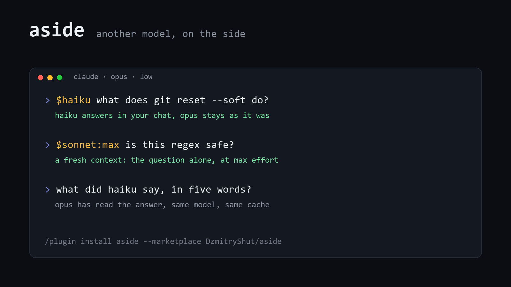

<div align="center">

# aside

**Ask another model a quick question without leaving your Claude Code session.**<br>
A subagent with a fresh context answers in your chat. Your session's model, effort and prompt cache stay as they were.

[](LICENSE)
[](#install)



</div>

```
$haiku what does git reset --soft do?          a quick fact, cheap and fast
$haiku:low where is the config parsed?         reads and searches the repo
$sonnet:max is this regex safe?                a second opinion that thinks hard
```

## Install

```
/plugin install aside --marketplace DzmitryShut/aside
```

Answer `y` to add the marketplace, then pick a scope. From a shell: `claude plugin install aside --marketplace DzmitryShut/aside`. In the desktop app: **+** next to the prompt, **Plugins**, **Add marketplace**.

## Use

Start a prompt with `$`, a model and, if you like, an effort:

| Spec | Asks |
| --- | --- |
| `$haiku`, `$sonnet`, `$opus`, `$fable` | that model, at the session's effort |
| `$haiku:low`, `$low:haiku` | that model at that effort: `low`, `medium`, `high`, `xhigh` or `max` |
| `$claude-haiku-5-5` | a model by its full id, with or without an effort |

Your question stays in the transcript and the answer shows up under it:

```
❯ $haiku what does git reset --soft do? Two sentences.
● Asked haiku on the side.
● haiku
  git reset --soft <commit> moves the current branch pointer to the given commit but leaves the index
  and working tree untouched, so all changes from the undone commits stay staged. This lets you rewrite
  or combine recent commits without losing any work.
```

The session's model reads the answer too, so a later prompt can build on it: "what did haiku say, in five words?" works. The subagent runs in the background, so you can keep typing; `/tasks` lists it while it works. For a follow-up, open a finished aside in `/tasks` and send it a message: the same subagent answers with what it already knows, and the answer shows up in your chat the same way.

A spec with no model, like `$low go`, is left to [once](https://github.com/DzmitryShut/once), which sets the effort for one prompt. Anything else goes through as typed, so `$HOME is wrong` and `costs $5` are safe.

## Why not switch the model?

Switching the session's model sends the whole conversation to a model that has none of it cached, so it is written into that model's cache from scratch. In a 160k Opus session one `$haiku` switch cost $0.160 against $0.085 for staying on Opus ([once's benchmark](https://github.com/DzmitryShut/once/blob/main/bench/results.md)).

aside never sends the conversation. The subagent starts with a short system prompt of its own, three read-only tools and your question, about 5k tokens of input, so a question costs the same in a 10k or a 200k session. Measured in an Opus session of about 45k tokens:

| Question | Subagent requests | Cost | Requests to the session's model |
| --- | ---: | ---: | ---: |
| `$haiku what does git reset --soft do? Two sentences.` | 1 | under $0.001 | 0 |
| `$sonnet:low where is the hand-back frame matched in hooks/register.tsx?` | 2, one Grep | $0.019 | 0 |

Claude Code 2.1.302, Claude Code's own estimates at API prices.

One thing still reaches the session's model: Claude Code's prompt suggestion, the grey guess for your next prompt, is a background request to it after a turn, and the turn an answer arrives in counts. Turn suggestions off in `/config` (**Prompt suggestions**) or with `CLAUDE_CODE_ENABLE_PROMPT_SUGGESTION=false`, and an aside makes no request to the session's model at all.

## And `/btw`?

Claude Code's own `/btw` asks the session's model over the session's conversation, in one reply with no tools; a question that needs a file read gets "ask in the main conversation". aside asks the model you pick, without the conversation, and the subagent can read and search the repo.

## How it works

- The prompt goes in as typed. aside answers the turn it starts with "Asked haiku on the side." and no model request.
- The subagent is `aside:ask`: Read, Glob and Grep, no CLAUDE.md, and nothing of your conversation. On a build without Glob or Grep, the built-in Explore agent stands in. Its line in the main model's agent list says it is aside's and not for the model's own tasks. It stays listed because Claude Code resumes only a listed type, and a follow-up is a resume.
- Each subagent is named after its spec (`aside-haiku-low-k3f9`). The name sets its model, and its effort on every request it makes.
- The answer comes back as Claude Code's hand-back, a hidden message the session's model reads in later prompts. aside answers the turn it starts as well, draws the hand-back as the answer, and hides that turn's placeholder reply. ctrl+o shows the raw message.
- An answer that lands while the session's model is busy with another prompt is read there, with a note to leave it alone. A question typed while the model works gets the same note.
- A subagent that stops without an answer, say on a model id that does not exist, leaves a line in the transcript saying so.

## Develop

```
claude --plugin-dir /path/to/aside
claude plugin validate .
claude plugin test .
```

All of it is [`hooks/register.tsx`](hooks/register.tsx).

## License

[MIT](LICENSE)
